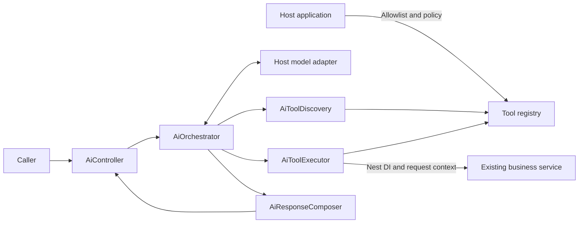

# NestJS AI middleware architecture and delivery plan

`nestjs-ai-middleware` is a reusable NestJS dynamic module that lets authenticated users access selected business capabilities in natural language. The host supplies an initialized model and registers its existing services. The model requests tool calls. The application decides which calls may run and what data may leave the service boundary.

## Component boundaries

| Component | Responsibility | Phase |
| --- | --- | --- |
| `AiModule` | Validate configuration, wire providers, and accept the host's model via `forRoot()` or `forRootAsync()`. | 1 |
| `AiToolRegistry` | Build an immutable in-memory index from the module allowlist, `@AiService()` classes, and `@AiTool()` methods. Keep Nest bindings private. | 1 |
| `AiToolExecutor` | Validate input, enforce host policy, resolve an existing Nest provider in the request context, invoke the registered method, and prepare its result. | 1 |
| `AiToolDiscovery` | Filter visible tools through host policy, rank by keyword and tool metadata, and cap selection. | 2 |
| `AiOrchestrator` | Drive a bounded generate → execute → report loop through `AiModel`. Own the request budget and validated transcript. | 2 |
| `AiController` | Mount the configurable `POST /ai` route through Nest. Authenticate, validate, build trusted context, and return the HTTP response. | 2 |
| `AiResponseComposer` | Validate and render supported text, list, table, chart, entity, data, and form blocks. | 3 |
| Bookkeeping | Record bounded run, model usage, and tool outcomes through an optional store. | 2 |
| Optional persistence | Retain authorized conversations and discovery data. Provide an action store when write support is enabled. | 4 / confirmed writes |

The diagram shows the intended HTTP flow through Phase 3. In Phase 1, the host invokes `AiToolExecutor` from trusted application code or a test. FR-001 through FR-003 define the complete foundation.

## Delivery phases

| Phase | Shippable outcome | Acceptance gate |
| --- | --- | --- |
| 1. Core foundation | Installable NestJS module, model contract, decorators, in-memory registry, and authorized read-only executor. Include a minimal Nest test app, a custom model example, an integration README, and deterministic Jest tests. | A consumer imports a packed build and executes an allowlisted service using the host's request context. TP-001 covers startup, boundaries, and execution. |
| 2. Orchestration and HTTP | Authenticated configurable `POST /ai`, deterministic discovery, bounded multi-step reads, text responses, and optional database-backed run and usage bookkeeping. | A fake model completes a multi-tool request. Verify guard order, request scope, protocol errors, deadlines, custom routes, and durable bookkeeping when configured. |
| 3. Structured responses | Add validated lists, tables, charts, entities, and data blocks for read workflows. | Structured-output and text-only adapters both return valid client responses. |
| 4. Optional integrations | SDK adapters, persistent conversations, SQLite bookkeeping, observability integrations, streaming, and semantic discovery. | Core remains usable without external SDKs or a database. Test transcript ownership and preserve executor policies across extensions. |
| Future confirmed writes | Add forms, approval, durable action state, and host-backed idempotent dispatch behind an explicit opt-in. | Test atomic claims, replay, permission changes, expiry, crash recovery, and mutation deduplication. |

The first public release is read-only for business tools. Run accounting is an optional infrastructure operation. Optional integrations and confirmed writes have their own release and backlog entries. [Read-only release](../../planning/releases/rel-001.md), [scale and integrations](../../planning/releases/rel-002.md), [confirmed writes](../../planning/releases/rel-003.md), [end-to-end release tests](../test-plans/tp-002.md).

## Design tradeoffs

| Choice | Benefit and cost |
| --- | --- |
| Small model adapter and custom loop | Provider choice and execution policy stay independent. Adapters must normalize their SDK's messages, tool calls, and errors. |
| Explicit local JSON Schema plus `@AiArgs()` | One portable runtime contract feeds validation and tool selection. A service using DTOs needs a schema or a future derivation helper. |
| Allowlisted, class-token providers | Common Nest services integrate with a class reference. Custom DI tokens, alias-only registrations, and ambiguous provider ownership need a later explicit binding design. |
| Permission decorators with a host policy | Services declare permission labels on the class or method. A host-provided policy enforces those requirements and checks access to the resource named in the validated arguments. |
| Sequential by default | Predictable execution and easier reasoning about request-scoped state. Parallelism needs explicit host opt-in for independent reads. |
| In-memory code-owned registry | Bootstrap validates executable capabilities without a database. Separate stores hold bookkeeping, optional history, and future approval state. [Bookkeeping and persistence](../services/srv-001.md). |
| Native Nest controller | Retains Nest guard execution and global prefix support. `forRootAsync()` takes the endpoint and guard classes outside the options factory so Nest can register route metadata during module setup. |

## Package and integration

Ship TypeScript declarations and a documented public entry point. Keep `@nestjs/common` and `@nestjs/core` as peer dependencies and align with the host's Nest major. Place host-facing interfaces in `src/contracts/`. The Nest module and `src/config/` handle provider registration, configuration validation, and building the tool registry at bootstrap. The orchestrator drives requests, and the executor, security, conversation, and logging components handle their respective runtime operations. Verify import, declaration resolution, and decorator metadata with an independent consumer fixture.

For persistence, the host supplies one initialized `database.adapter` from the SQLite, PostgreSQL, or MongoDB package. The adapter persists only plugin records. The core controls session rules, model history selection, and run bookkeeping. The retail example uses `data/nest-ai-middleware.sqlite` in the plugin checkout. It loads bounded context for the model and scopes transcript reads and follow-ups to the authenticated subject and tenant. An optional host-supplied `AiLogger` receives screened input, tool outcomes, and screened output with the run and session IDs. Tool registrations carry stable IDs, and each invocation has its own ID.

`AiRunReader` exposes run status, accepted output, and bookkeeping metadata to the authorized session owner. `AiToolEvents` delivers committed tool attempts to authorized in-process subscribers. The SQLite, PostgreSQL, and MongoDB adapters use the same `AiDatabaseAdapter` contract. [ADR-003](../adr/adr-003.md)

## Initial compatibility and integration decisions

- **Runtime.** Start with NestJS 12 and Node.js 26 LTS, using the latest stable patch releases when locking dependencies. Use ESM for the library and reference app. Claim compatibility for other consumer configurations after a packed-build test verifies them. [NestJS releases](https://github.com/nestjs/nest/releases/latest), [Node.js release schedule](https://nodejs.org/en/about/previous-releases).
- **HTTP.** Use Nest's `NodeAdapter` in the Phase 2 reference app. The core stays adapter-independent. Qualify additional adapters with end-to-end tests before documenting their support. [NestJS HTTP adapters](https://docs.nestjs.com/techniques/performance).
- **Access control.** The host can pass Nest `authenticationGuards` and `authorizationGuards` directly to the AI module. The guards protect access to `/ai`. Tools use `@AiPermissions()` and a required host policy for tool and resource checks. [Authorization and host integration](../auth/auth-001.md).

Start with [the proposed public API](arch-002.md), [provider resolution](../adr/adr-001.md), and [the authorization specification](../auth/auth-001.md).
