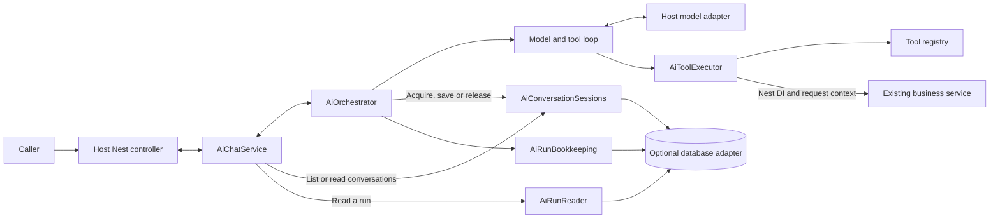

# NestJS AI middleware architecture and delivery plan

`nestjs-ai-middleware` is a reusable NestJS dynamic module that lets authenticated users access selected business capabilities in natural language. The host supplies an initialized model and registers its existing services. The model requests tool calls. The application decides which calls may run and what data may leave the service boundary.

## Component boundaries

| Component                                       | Responsibility                                                                                                         |
| ----------------------------------------------- | ---------------------------------------------------------------------------------------------------------------------- |
| `AiModule`                                      | Validates configuration and registers the host model and middleware providers.                                         |
| `AiToolRegistry`                                | Builds an in-memory index from `@AiTool()` methods and keeps Nest bindings private.                                    |
| `AiChatService`                                 | Exposes chat, conversation, and backend run reads to the host.                                                         |
| `AiOrchestrator`                                | Applies the run deadline, loads history, and saves the accepted turn.                                                  |
| `runModelLoop`                                  | Sends tool definitions to the model, executes its authorized requests in order, and returns the final text.            |
| `AiToolExecutor`                                | Uses Nest guards to discover available tools, validates arguments, and executes the tool in the original Nest context. |
| `AiPromptSecurity`                              | Checks inputs and model outputs according to the host's independent switches.                                          |
| `AiConversationSessions`                        | Acquires session leases, loads history, saves accepted turns, and handles conversation reads.                         |
| `AiRunBookkeeping` and `AiRunReader`             | Write and read run records and events through the same optional database adapter.                                      |

The host can call `AiToolExecutor` directly from trusted application code. The full chat flow uses the host's model to select among tools offered by the executor.

The data-flow overview connects startup, chat, tools, attachments, and storage. The session lifecycle shows how a saved chat acquires a lease, saves its turn, and releases the lease. [Connected flows](arch-003.md#how-the-flows-connect), [session lifecycle](arch-003.md#4-manage-the-conversation-session).

## Delivery phases

The phases below describe the release roadmap. The component overview and public API describe what is available in the current checkout.

| Phase                     | Shippable outcome                                                                                                                                                                                                           | Acceptance gate                                                                                                                                               |
| ------------------------- | --------------------------------------------------------------------------------------------------------------------------------------------------------------------------------------------------------------------------- | ------------------------------------------------------------------------------------------------------------------------------------------------------------- |
| 1. Core foundation        | Installable NestJS module, model contract, decorators, in-memory registry, and authorized read-only executor. Include a minimal Nest test app, a custom model example, an integration README, and deterministic Jest tests. | A consumer imports a packed build and executes a decorated service method using the host's request context. TP-001 covers startup, boundaries, and execution. |
| 2. Orchestration and HTTP | Authenticated host endpoint, deterministic discovery, bounded multi-step reads, text responses, and optional database-backed run and usage bookkeeping.                                                                     | A fake model completes a multi-tool request. Verify guard order, request scope, protocol errors, deadlines, and durable bookkeeping when configured.          |
| 3. Structured responses   | Add validated lists, tables, charts, entities, and data blocks for read workflows.                                                                                                                                          | Tool-capable adapters return valid client responses with or without structured output.                                                                       |
| 4. Optional integrations  | SDK adapters, persistent conversations, SQLite bookkeeping, observability integrations, streaming, and semantic discovery.                                                                                                  | Core remains usable with a custom model and without a database. Test transcript ownership and preserve executor policies across extensions.                   |
| Future confirmed writes   | Add forms, approval, durable action state, and host-backed idempotent dispatch behind an explicit opt-in.                                                                                                                   | Test atomic claims, replay, permission changes, expiry, crash recovery, and mutation deduplication.                                                           |

The release plan starts with read-only business tools. The current executor also supports opt-in create and update operations with host-owned business authorization. The confirmed-action workflow is future work. Optional integrations and confirmed writes have their own release and backlog entries. [Read-only release](../../planning/releases/rel-001.md), [scale and integrations](../../planning/releases/rel-002.md), [confirmed writes](../../planning/releases/rel-003.md), [end-to-end release tests](../test-plans/tp-002.md).

## Design tradeoffs

| Choice                                 | Benefit and cost                                                                                                                                                                                      |
| -------------------------------------- | ----------------------------------------------------------------------------------------------------------------------------------------------------------------------------------------------------- |
| Small model adapter and custom loop    | Provider choice and execution policy stay independent. Adapters must normalize their SDK's messages, tool calls, and errors.                                                                          |
| Explicit tool input schema             | The decorator declares the JSON Schema. The method receives the validated object with named fields.                                                                                                   |
| Allowlisted, class-token providers     | Common Nest services integrate with a class reference. Custom DI tokens, alias-only registrations, and ambiguous provider ownership need a later explicit binding design.                             |
| Nest guards and business authorization | Class and method guards determine which tools the model can see and invoke. Business methods check access to resources named in the validated arguments.                                              |
| Sequential tool execution              | Calls run in order within the same request scope. A later model round can use earlier tool results.                                                                                                   |
| In-memory code-owned registry          | Bootstrap validates executable capabilities without a database. One optional database adapter stores conversation history and run bookkeeping. [Bookkeeping and persistence](../services/srv-001.md). |
| Host-owned Nest controller             | The app chooses its route, guards, validation, and presentation. The controller calls `AiChatService` with the authenticated caller and original request context.                                     |

## Package and integration

Ship TypeScript declarations and a documented public entry point. Keep `@nestjs/common` and `@nestjs/core` as peer dependencies and align with the host's Nest major. Place host-facing interfaces in `src/contracts/`. The Nest module and `src/config/` handle provider registration, configuration validation, and building the tool registry at bootstrap. The orchestrator drives requests, and the executor, security, conversation, and logging components handle their respective runtime operations. Verify import, declaration resolution, and decorator metadata with an independent consumer fixture.

For persistence, the host supplies one initialized `database.adapter` from the SQLite, PostgreSQL, or MongoDB package. The adapter persists only plugin records. The core controls session rules, model history selection, and run bookkeeping. The retail example uses `data/nest-ai-middleware.sqlite` in the plugin checkout. It loads all saved turns in order and scopes transcript reads and follow-ups to the authenticated subject and tenant. An optional host-supplied `AiLogger` receives accepted input, eligible tool outcomes, and accepted output with the run and session IDs. Tool registrations carry stable IDs, and each invocation has its own ID.

The host backend injects `AiChatService` to read run status, accepted output, and committed bookkeeping records for the authorized session owner. The SQLite, PostgreSQL, and MongoDB adapters use the same `AiDatabaseAdapter` contract. [ADR-003](../adr/adr-003.md)

## Initial compatibility and integration decisions

- **Runtime.** The workspace builds and tests on Node.js 26 with NestJS 12. The packaged library also supports Node.js 24 and NestJS 11. The npm workflow tests the packed packages in that consumer runtime. [Release workflow](../../../.github/workflows/publish.yml).
- **HTTP.** The retail reference app uses Nest's `ExpressAdapter`. The core delegates HTTP handling to the host. Qualify additional adapters with end-to-end tests before documenting their support. [NestJS HTTP adapters](https://docs.nestjs.com/techniques/performance).
- **Access control.** Host Nest guards protect the application endpoint. Tools use the service and method guards for access checks and business methods for resource checks. [Authorization and host integration](../auth/auth-001.md).

Start with [the public API](arch-002.md), [provider resolution](../adr/adr-001.md), and [the authorization specification](../auth/auth-001.md).
