# Middleware data-flow diagrams

Boxes name functions or operations, diamonds show branches, and arrow labels describe the data passed between steps. The host supplies the verified caller and the original Nest request context. [Component overview](arch-001.md), [public API and model protocol](arch-002.md).

## How the flows connect

`AiOrchestrator.run()` connects the chat paths. Startup supplies the tool registry. The database adapter supplies session history and stores conversation turns and run records for later reads.

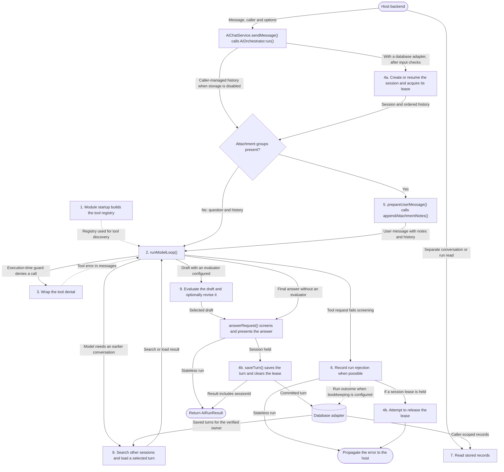

[1. Startup](#1-register-the-module-and-discover-tools) · [2. Model and tool loop](#2-answer-from-context-call-a-tool-or-return-a-fallback) · [3. Tool denial](#3-handle-an-execution-time-tool-denial) · [4. Session lifecycle](#4-manage-the-conversation-session) · [5. Attachments](#5-process-inline-files-and-stored-attachments) · [6. Run rejection](#6-reject-a-run-when-tool-request-screening-fails) · [7. Stored reads](#7-read-stored-conversations-and-run-records) · [8. History recall](#8-recall-a-turn-from-another-session) · [9. Answer evaluation](#9-evaluate-the-answer-before-presentation)

## 1. Register the module and discover tools

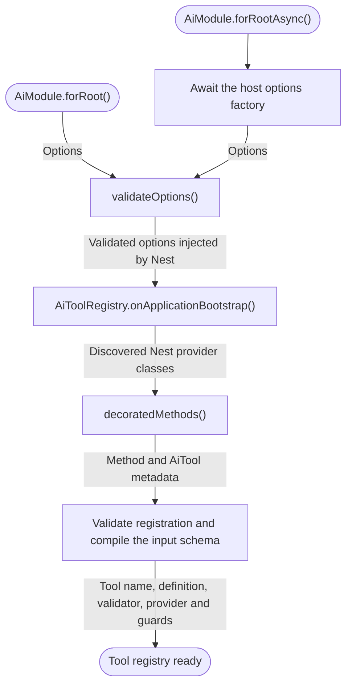

The `@AiTool()` decorator adds metadata to the service method. The registry resolves the owning Nest module when it builds the tool entry. Runtime discovery in the model loop checks the caller's access to those entries. [Model and tool loop](#2-answer-from-context-call-a-tool-or-return-a-fallback), [module registration](../../../packages/core/src/ai.module.ts), [tool registry](../../../packages/core/src/config/ai-tool-registry.ts).

## 2. Answer from context, call a tool, or return a fallback

`runModelLoop()` gives the model system instructions to answer from existing context, request an eligible tool for fresh application data or an action, and return a fallback for out-of-domain requests. The host can define the application domain and fallback in its own model instructions. The middleware follows the model's `AiModelResponse.kind`.

A saved chat loads history before entering this loop and commits the accepted turn after presentation. [Loading history](#4a-acquire-the-lease-and-load-history), [saving the turn](#4b-save-the-accepted-turn-or-release-the-lease).

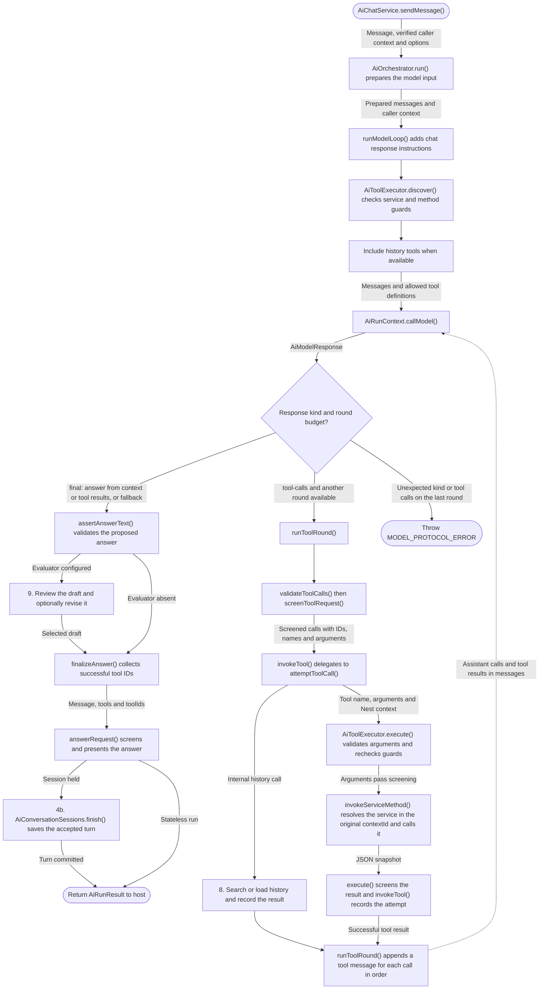

`runToolRound()` validates and screens the batch, then appends the assistant's tool-call message before dispatch. Each tool result carries the corresponding call ID, and the next round receives the updated message list. The final reply's `tools` and `toolIds` list successful calls and are empty when the model answers on the first round. A denied tool call produces a result for the next round. A screening failure exits the loop and reaches the orchestrator's error path. [Tool denial](#3-handle-an-execution-time-tool-denial), [run rejection](#6-reject-a-run-when-tool-request-screening-fails), [model loop implementation](../../../packages/core/src/orchestrator/ai-answer.ts).

## 3. Handle an execution-time tool denial

This path begins after discovery has offered the tool and the model has requested it.

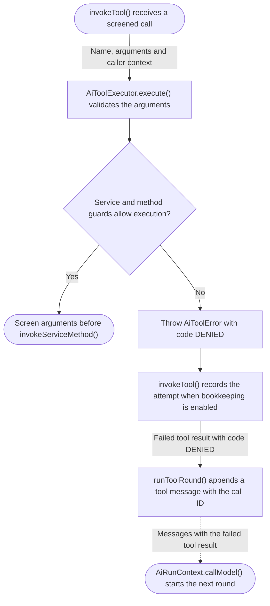

The guard denial stops dispatch before the service method. Once the batch is processed, the model can answer or request another tool within the remaining limits. The session lease stays with the chat run throughout the loop. [Model and tool loop](#2-answer-from-context-call-a-tool-or-return-a-fallback), [session lifecycle](#4-manage-the-conversation-session), [tool executor](../../../packages/core/src/executor/ai-tool-executor.ts).

## 4. Manage the conversation session

`sessionId` identifies a conversation across requests. `runId` identifies one request and owns its lease while that request is in flight. With a database adapter configured, the host omits `sessionId` to start a conversation and sends the returned ID with the same verified subject and tenant to resume it.

### 4a. Acquire the lease and load history

`AiOrchestrator.run()` rejects nonempty caller-supplied history when session storage is enabled. With storage disabled, it accepts caller-managed history and rejects `sessionId` with `SESSION_UNAVAILABLE`. For a saved chat, `createRunContext()` sets up logging and attempts to start run bookkeeping. The orchestrator then screens the question before calling `begin()`.

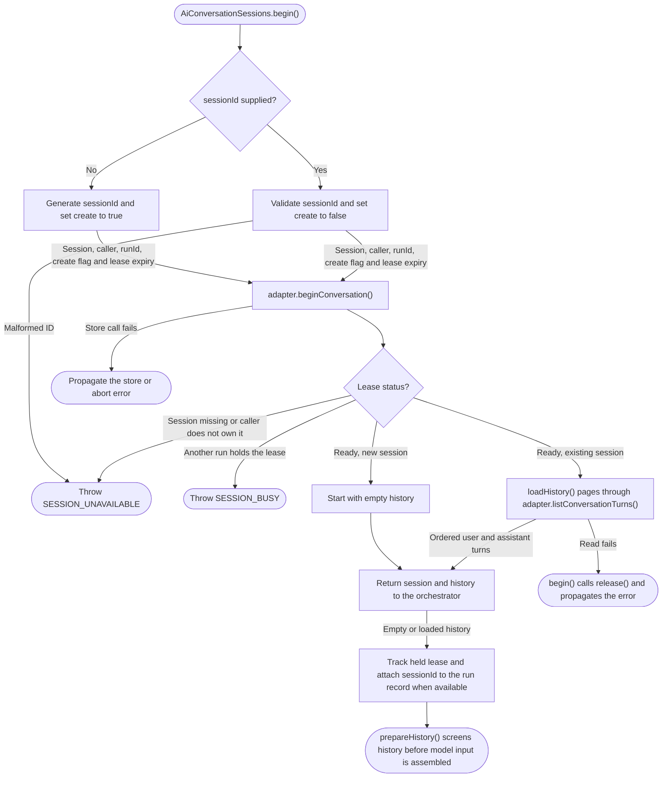

The adapter scopes the lease to the session owner. Another run can acquire the lease after it is released or expires. History enters the model loop alongside the current user message, which may include attachment notes. [Attachments](#5-process-inline-files-and-stored-attachments), [model and tool loop](#2-answer-from-context-call-a-tool-or-return-a-fallback), [session implementation](../../../packages/core/src/conversation/ai-conversation-sessions.ts).

### 4b. Save the accepted turn or release the lease

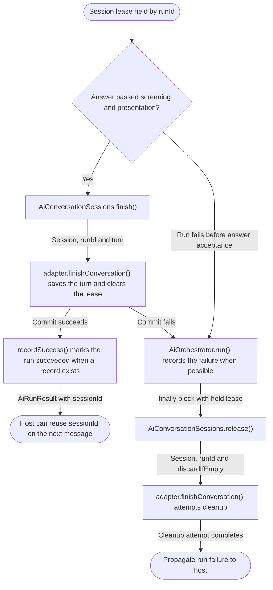

The accepted turn stores the user message, presented answer, and successful tool identifiers. `release()` uses a separate cleanup timeout and asks the adapter to discard the session if it is empty. If cleanup fails, the lease remains eligible for takeover after its expiry. Both conversation reads and run reads use the same configured adapter. [Run rejection](#6-reject-a-run-when-tool-request-screening-fails), [stored reads](#7-read-stored-conversations-and-run-records), [orchestrator](../../../packages/core/src/orchestrator/ai-orchestrator.ts), [database contract](../../../packages/core/src/contracts/ai-database.ts).

## 5. Process inline files and stored attachments

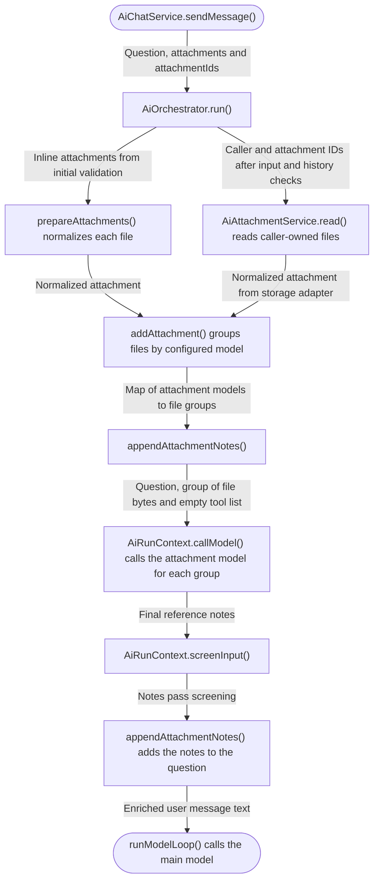

`AiAttachmentService.create()` gives the caller an ID for later requests. The attachment model receives the file bytes. The enriched user message enters the model loop and becomes the saved user turn when a session is active. [Model and tool loop](#2-answer-from-context-call-a-tool-or-return-a-fallback), [saving the turn](#4b-save-the-accepted-turn-or-release-the-lease), [attachment processing](../../../packages/core/src/orchestrator/ai-attachments.ts).

## 6. Reject a run when tool request screening fails

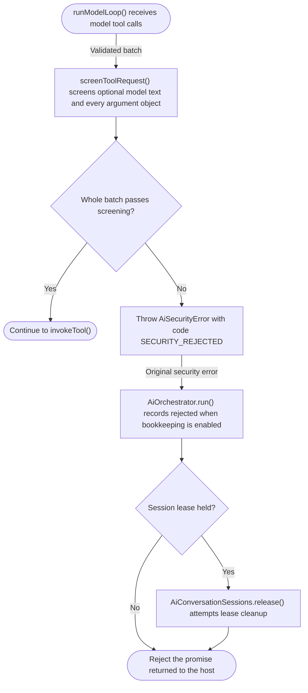

Screening checks the entire batch before any tool executes. A rejection reaches the session cleanup path if the run already acquired a lease. [Model and tool loop](#2-answer-from-context-call-a-tool-or-return-a-fallback), [releasing the lease](#4b-save-the-accepted-turn-or-release-the-lease), [run failure and cleanup](../../../packages/core/src/orchestrator/ai-orchestrator.ts).

## 7. Read stored conversations and run records

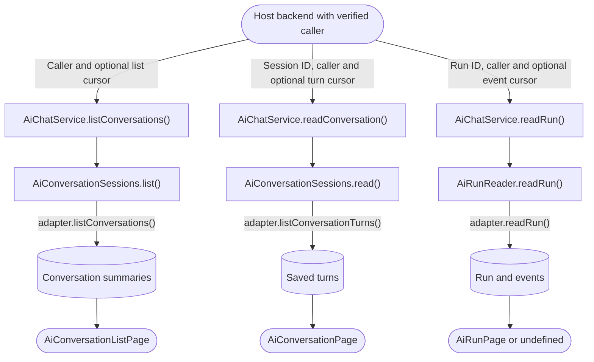

These are separate host calls that retrieve the committed turns and run records. Each cursor belongs to its own result type. [Session lifecycle](#4-manage-the-conversation-session), [chat service](../../../packages/core/src/services/ai-chat.service.ts), [run reader](../../../packages/core/src/logging/ai-run-reader.ts).

## 8. Recall a turn from another session

An active session and a database adapter that implements `searchConversationTurns()` make recall available. The model chooses when to search. The adapter searches the verified caller's committed turns across other sessions and returns at most five matches. `createHistoryTools()` holds those turns for the current run and gives the model question previews and keyword matches. Only a later load call with a candidate ID can put that candidate's full question and answer into context. [Session lifecycle](#4-manage-the-conversation-session) · [History tools](../../../packages/core/src/orchestrator/ai-history-tools.ts).

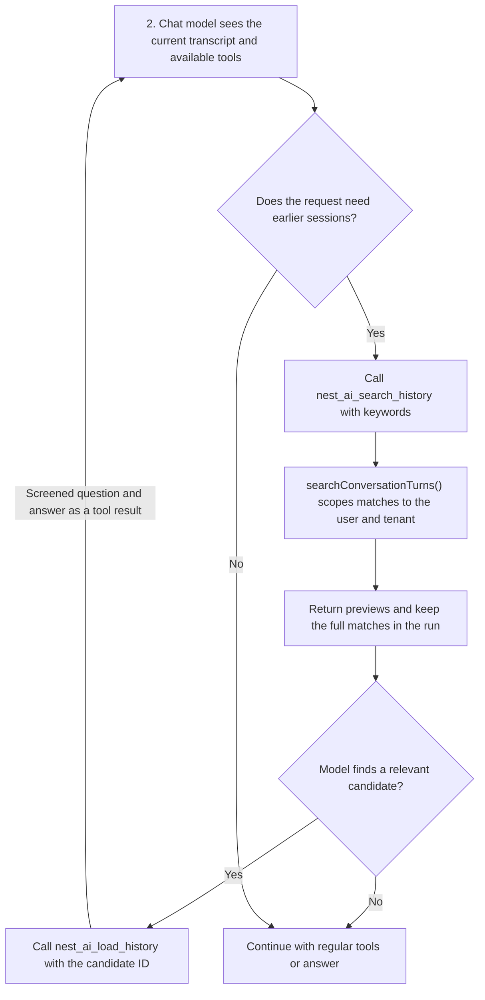

## 9. Evaluate the answer before presentation

When `answerEvaluator` is configured, `reviewAndReviseAnswer()` compares the proposed answer to the current request and the evidence available in the run. A low score triggers one text-only revision. A valid revised draft receives a second review, and the higher-scoring draft proceeds to presentation and session save. [Model loop](#2-answer-from-context-call-a-tool-or-return-a-fallback) · [Evaluator](../../../packages/core/src/orchestrator/ai-answer-evaluator.ts).

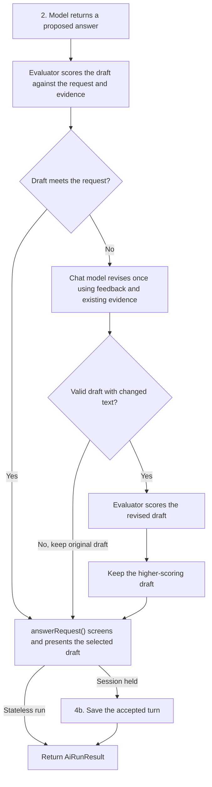
